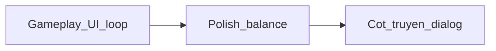

# Gameplay/UI trước — cốt truyện sau

## Kết luận

**Đúng:** làm gameplay + UI trước, cốt truyện sau. Hiện đã có khung sử (3 chương, story/mission ngắn mỗi ải) nhưng loop chính vẫn là đánh phó bản — viết hội thoại sớm sẽ phải sửa lại khi UI/flow đổi.

## Vì sao thứ tự này

- Story gắn vào màn hình đã có (briefing trước trận, kết ải, thu phục) — UI/flow ổn thì gắn chữ một lần là xong.
- Data story đã có chỗ gắn: [`data/progression.json`](../../data/progression.json) `stageLinks` + UI trong [`js/ui.js`](../../js/ui.js) `renderCampaign` — chưa cần hệ thống mới.
- Tránh viết nhiều thoại rồi phải cắt khi đổi layout bày trận / trang bị / thưởng.

## Phase A — Gameplay / UI (làm trước)

Thứ tự đề xuất (theo độ ảnh hưởng tới cảm giác có game):

1. **Loop Phó Bản rõ hơn** — preview địch/thưởng trước khi đánh; sau thắng hiện rõ danh vọng / thu phục / mở khóa.
2. **Thành chính / kinh tế** — nâng nhà, sản xuất bạc–lương cảm nhận được giữa các ải.
3. **Tửu Quán / tướng** — chiêu mộ, cường hóa, đeo đồ (trang bị wiki vừa xong) thành một chuỗi mượt.
4. **Trận đấu** — tinh chỉnh feedback (sĩ khí, trận pháp, kết trận) nếu còn chỗ khó hiểu.
5. **Lôi đài / Thế giới** — content phụ sau khi chính tuyến chơi ổn.

Không đụng cốt truyện dài trong phase này — giữ `story`/`mission` ngắn như hiện tại.

## Phase B — Cốt truyện (làm sau)

Khi loop A ổn:

1. Mở rộng `stageLinks` thành briefing modal trước trận + epilogue sau clear.
2. Dialog đơn giản (portrait + text), chưa cần branching.
3. Bám Diễn Nghĩa theo 3 chương đã có; thêm chương chỉ khi gameplay chịu nổi.

## Việc không làm lúc này

- Hệ nhánh chọn phe / multiple ending
- Cutscene 3D / video
- Viết lại toàn bộ wiki lore thành novel in-game

## Bước tiếp theo ngay

Khi bạn bảo làm tiếp: bắt đầu Phase A mục 1–2 (UI phó bản + cảm giác thành chính), trừ khi bạn chỉ định mảng khác.